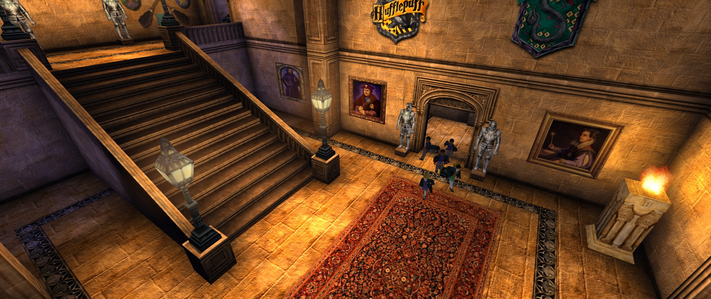
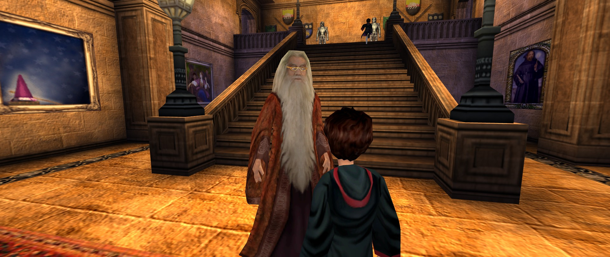
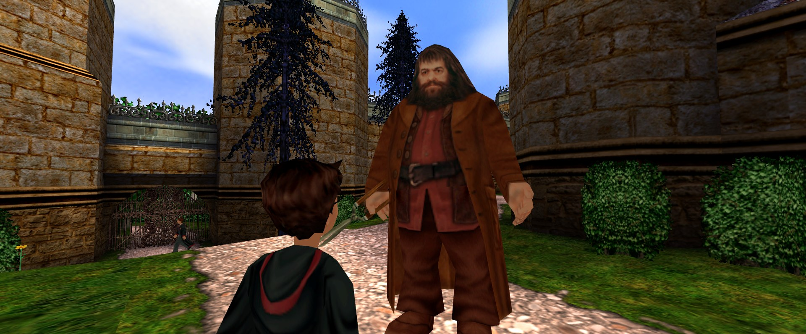
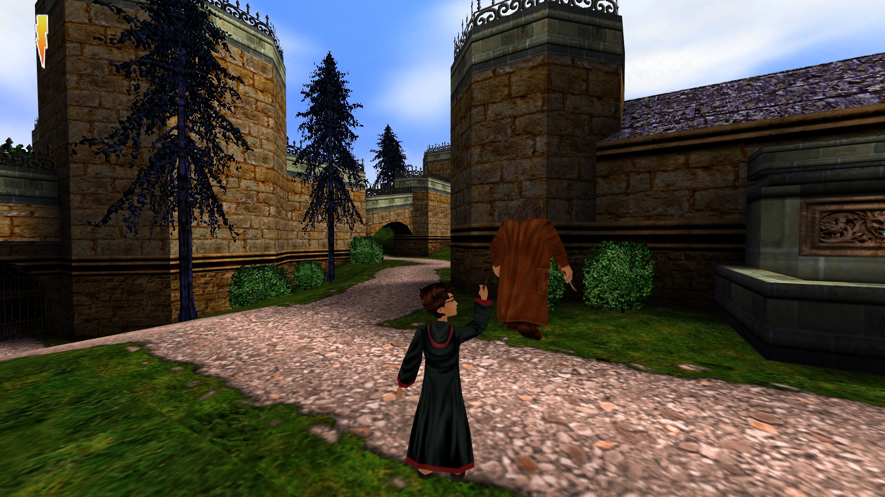
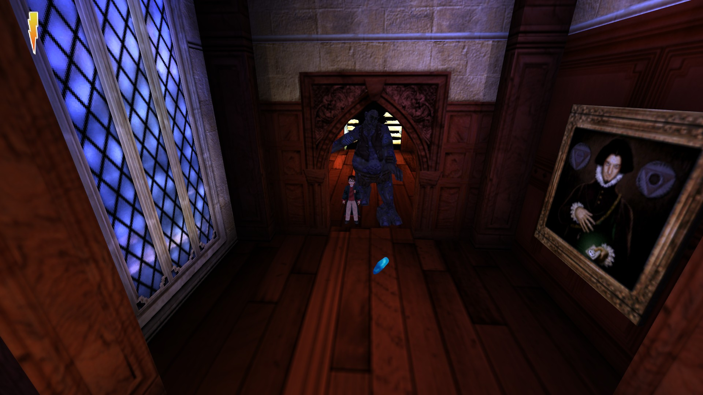
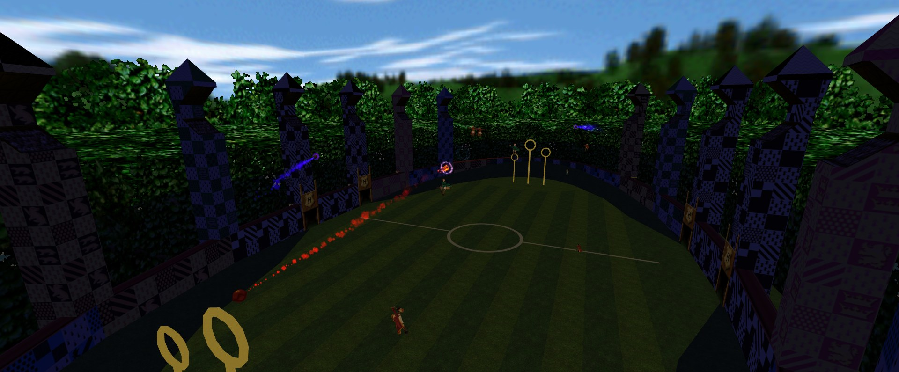
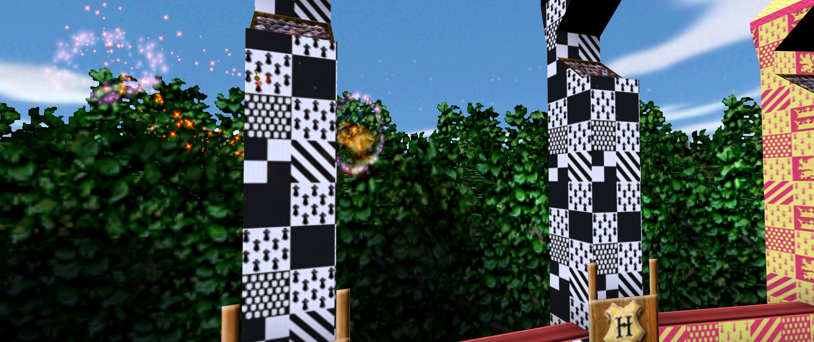
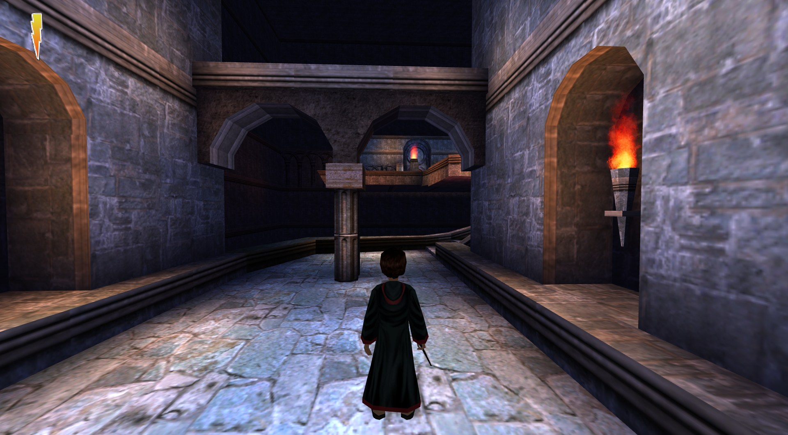

<p align="center">
  <picture>
    <source media="(prefers-color-scheme: dark)" srcset="images/branding/flipendo-logo-dark.png">
    <source media="(prefers-color-scheme: light)" srcset="images/branding/flipendo-logo.png">
    
  </picture>
</p>

<p align="center">
  <b>Play the first two Harry Potter PC games on a modern PC:<br>
  native resolution, real widescreen, no SafeDisc, moddable.</b><br>
  <sub>Philosopher's Stone / Sorcerer's Stone (2001) is playable from start to finish; Chamber of Secrets (2002) is in progress.<br>
  One open-source engine for both.</sub>
</p>

<p align="center">
  <a href="#screenshots">Screenshots</a> ·
  <a href="#status">Status</a> ·
  <a href="#how-to-play">How to play</a> ·
  <a href="#extras-and-mods">Extras &amp; mods</a> ·
  <a href="#community">Community</a> ·
  <a href="CONTRIBUTING.md">Contributing</a> ·
  <a href="ROADMAP.md">Roadmap</a>
</p>

<p align="center">
  
</p>

Flipendo is one engine for KnowWonder's first two Harry Potter games on PC, built on
[SurrealEngine](https://github.com/dpjudas/SurrealEngine), an open-source reimplementation of Unreal Engine 1:

- **Harry Potter and the Philosopher's Stone** (*Sorcerer's Stone* in the US; 2001): **finished**, the whole story
  plays through.
- **Harry Potter and the Chamber of Secrets** (2002): **work in progress**. It starts and plays its first cutscenes;
  it isn't playable through yet.

Point it at your installed game and it plays that game. The levels, scripts, voices and music all come from your own
installation; Flipendo replaces only the engine underneath them.

**You need your own copy of the game.** Flipendo contains no game data.

Everything below is about Philosopher's Stone unless it says otherwise; Chamber of Secrets has its own
[status section](#chamber-of-secrets-work-in-progress).

## Why play it this way?

The 2001 release is getting hard to run. SafeDisc copy protection doesn't work on Windows 10/11, the menus stop at
1024x768 and widescreen needs community patches. Flipendo fixes all of that without touching your game files:

- **Any resolution, real widescreen.** 1080p, 1440p, 4K, ultrawide. The view gets wider instead of being cropped,
  the HUD and cutscene bars fill the screen, and the menu book keeps its shape.
- **Modern renderer.** Vulkan, Direct3D 11/12 or OpenGL instead of Direct3D 7.
- **No disc, no SafeDisc, no compatibility patches.** Point it at the installed game folder.
- **The same game.** Nothing is remade or altered. Optional extras (skippable cutscenes and storybooks, fast forward) can all
  be switched off with `--vanilla`.
- **Fixable.** Bugs in the original engine get fixed in source ([list](docs/re/hp1/original_bugs.md)).
- **Windows, Linux and macOS.**

## Screenshots

All taken in Flipendo at 1920x1080 from the original game files.

<table>
  <tr>
    <td></td>
    <td></td>
  </tr>
  <tr>
    <td></td>
    <td></td>
  </tr>
  <tr>
    <td></td>
    <td></td>
  </tr>
  <tr>
    <td colspan="2"></td>
  </tr>
</table>

## Status

### Philosopher's Stone: finished

> **The whole story has been played through, start to finish, in Flipendo** (October 2026). [Download it for
> Windows, Linux or macOS](https://github.com/kroplabeskidu/flipendo/releases/latest). Follow progress in [`ROADMAP.md`](ROADMAP.md).

| | |
|---|---|
| ✅ Works | The whole story, every level from the first lesson to the final encounter with Voldemort, tested by playing it through. Menus and options (incl. key rebinding), widescreen at any resolution, music, cutscenes, characters and their animations, spells and particle effects, doors, NPCs, Peeves, jelly beans, wizard cards, saving and loading |
| 🐧 Linux | Plays (tested on Fedora) |
| 🍎 macOS | Plays on Apple Silicon (tested on macOS 26) |
| ⚪ Not tested | The Quidditch League |

Playtesters are welcome: anything that looks or behaves differently from the original is a useful bug report.

### Chamber of Secrets: work in progress

Most of the engine work is shared with the first game, so Chamber of Secrets reuses it; what differs is being ported
now. It is not ready to play yet; the [roadmap](ROADMAP.md) has the full list.

| | |
|---|---|
| ✅ Works | Starts straight into a new game (tested on Linux), the opening cutscenes up to the Whomping Willow with subtitles (Enter skips them), the in-game menu and options at any resolution |
| 🟡 Partly | Sound effects and music play but aren't checked against the original yet |
| ❌ Not yet | Voices, the start menu (New Game / Load Game / Options), saving and loading, playing past the first scenes, the cutscene camera in the opening flyover |

If you try it, build from source (below) and point it at your Chamber of Secrets folder (retail 1.0, the one with
`system/Game.exe`). Bug reports are welcome, but expect rough edges.

## How to play

### What you need

- **Harry Potter and the Philosopher's / Sorcerer's Stone for PC (2001)**, installed: the folder with `System/`,
  `Maps/`, `Textures/` and so on. Known versions: UK 1.1, EN retail and a community No-CD,
  Russian (EA Hit-Parade) and its No-CD. If yours isn't
  recognised, the error shows a code (SHA-1); please [report it](CONTRIBUTING.md#other-game-versions).
- Or **Chamber of Secrets for PC (2002)**, to try the [work in progress](#chamber-of-secrets-work-in-progress).
- **Windows 10/11**, **Linux** (a distribution from 2024 or later), or a **Mac** with Apple Silicon.

### Get it running

Download the zip for your system from the [releases page](https://github.com/kroplabeskidu/flipendo/releases/latest)
and unzip it anywhere. On Windows, drag your game folder onto `SurrealEngine.exe`; on Linux and macOS, copy the game
folder from a Windows install (or the disc) and start it as `README-first.txt` in the zip says.

To build it yourself instead (a few minutes), you need
[Visual Studio 2026](https://visualstudio.microsoft.com/) with the *Desktop development with C++* workload, and
[Git for Windows](https://git-scm.com/download/win). In Git Bash:

```sh
git clone --recursive https://github.com/kroplabeskidu/flipendo
cd flipendo
tools/build.sh
build/Release/SurrealEngine.exe "C:/Games/Harry Potter"
```

The last line opens the game; use your own install folder in place of `C:/Games/Harry Potter`. If it doesn't start, the error says which file or folder is
missing: see [troubleshooting](docs/troubleshooting.md).

On **Linux**, copy the game folder from a Windows install (or the disc) and build it like this; the packages to
install first are in [CONTRIBUTING.md](CONTRIBUTING.md#linux):

```sh
git clone --recursive https://github.com/kroplabeskidu/flipendo
cd flipendo
bash tools/apply_patches.sh
cmake -S src/engine -B build-linux -G Ninja -DCMAKE_BUILD_TYPE=Release
cmake --build build-linux --target SurrealEngine
build-linux/SurrealEngine ~/Games/HarryPotter
```

### Launch options

| Option | What it does |
|---|---|
| `--skip-splash` | skip the logo screens (already the default; this one works with `--vanilla` too) |
| `--skip-intro` | New Game goes straight to the first level |
| `--vanilla` | turn off every extra the original doesn't have |
| `--logfile=flipendo.log` | write a log file (attach it to bug reports) |

## Extras and mods

Most are for Philosopher's Stone (HP1); the Games column says which also work in Chamber of Secrets (HP2), whose own
cutscene skip (Enter) is part of the original game. The faithful port and the additions are kept apart: an extra never
changes how the game plays unless it is switched on, and `--vanilla` switches all of them off.

| Extra | Games | Default | What it does |
|---|---|---|---|
| Cutscene skip | HP1 | on | "Press Space to skip" during cutscenes |
| Storybook skip | HP1 | on | "Press Space to skip" in storybooks (New Game intro, chapter interludes) |
| Fast forward | HP1, HP2 | on | hold Shift to play 2.5x as fast |
| Discord status | HP1 | on | friends on Discord see which level you're in and Gryffindor's house points; `--no-discord` turns it off |
| 60 FPS cap | HP1, HP2 | on | the game runs at most 60 frames a second, as the original was played (some of its movement goes wrong at high frame rates); `--fps=<n>` for another limit, `--fps=0` for none |
| Improved movement | HP1 | on | HP2's controls: Left / Right strafe and the mouse turns, Harry keeps moving while you hold a spell (the mouse aims it; he can jump with it, and climbs again once it is cast), and the mouse looks up and down while you move. Saves work with it on or off; `--classic-movement` turns it off |
| Map fixes | HP1 | on | fixes broken paths in the original maps (Peeves now flies off after the Lev_Tut3b duel instead of drifting through the walls) |
| Texture packs | HP1, HP2 | on | `.dds` files in `Textures/<package>/<group>/<name>.dds` replace the game's textures: the layout of the DirectX 11 renderer's texture packs, such as the ESRGAN Upscale Pack (unpack it into the game folder) |
| Splash skip | HP1, HP2 | on | no logo screens at start: HP1 opens on the main menu, HP2 on its start menu |
| Intro skip | HP1 | off | `--skip-intro`: New Game goes straight to the first level |

More is coming (an in-game page to switch these, more extras): see the [roadmap](ROADMAP.md#extras-for-hp1-srchp1mods),
and [docs/modding.md](docs/modding.md) to write a mod today.

## Community

- **Bugs and ideas**: open an issue. Include your game version, what you did, and the log (`--logfile=...`).
- **Help out**: playtesting, modding, C++. Most of it needs no programming:
  [CONTRIBUTING.md](CONTRIBUTING.md). Reverse engineering isn't open to outside help.
- **Android port (unofficial)**: someone ported Flipendo to Android in a fork,
  [flipendo-droid](https://github.com/Ihor-Ihorevych/flipendo-droid). It isn't part of this project: I haven't
  reviewed it and don't endorse it. Try it at your own discretion. Thank you to its author for the work!

## Legal

Flipendo's own code is copyright 2026 the Flipendo authors and open source under the
[GNU General Public License, version 3](LICENSE): free to use, modify and share, as long as what you share keeps its
source open under the same licence. `src/engine/` is SurrealEngine (zlib licence). Flipendo is an independent project, **not
affiliated with or endorsed by SurrealEngine, EA, Warner Bros. or KnowWonder**; please report problems here, not to
SurrealEngine. It is a reimplementation written from studying how the original game behaves (its scripts, data and
binaries), so that the game's own files run on a new engine. It contains no Epic, EA or KnowWonder code or data.

Harry Potter is a trademark of Warner Bros. Entertainment. The game data is copyright EA / KnowWonder and is not
included.
